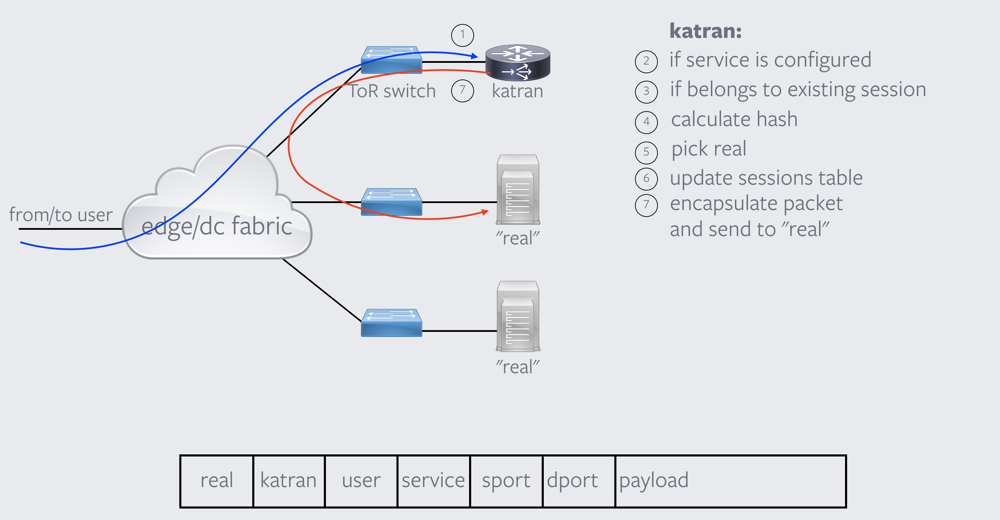
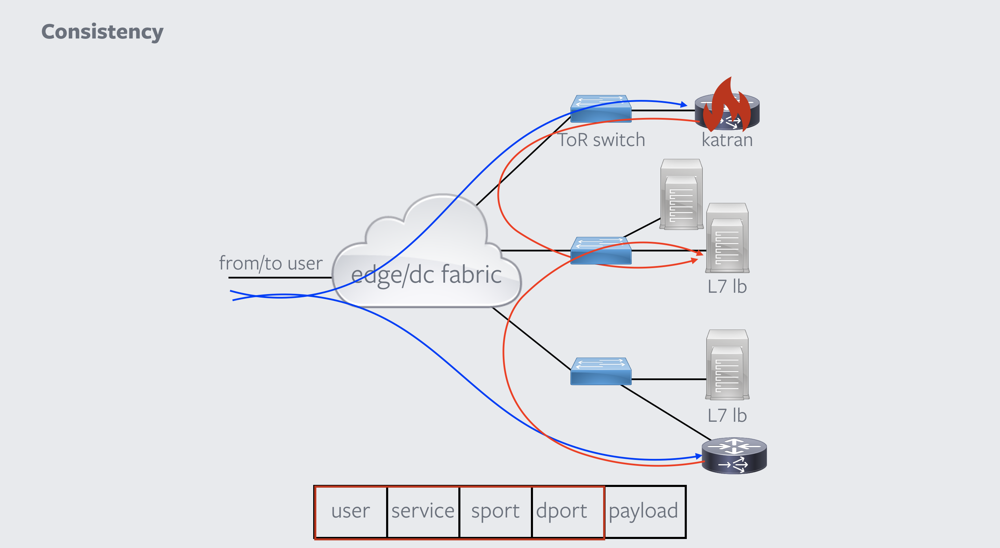

  

  

Katran is a C++ library and [`BPF`](https://en.wikipedia.org/wiki/Berkeley_Packet_Filter) program to build high-performance
layer 4 load balancing forwarding plane. Katran leverages [`XDP infrastructure`](https://www.iovisor.org/technology/xdp)
from the kernel to provide an in-kernel facility for fast packet's processing.

## Katran's key features

1. Blazing fast (especially w/ XDP in driver mode).
2. Performance scaling linearly with a number of NIC's RX queues.
3. RSS friendly encapsulation.

See the detailed features' description below :

## Documentation's sections

1. [`README`](README.md) (this file) - a generic overview of katran.
2. [`USAGE`](USAGE.md) - the detailed description of how katran's library can be used, configured or changed.
3. [`DEVELOPING`](DEVELOPING.md) - description of how developing process looks like: how to build and test katran.
4. [`EXAMPLE`](EXAMPLE.md) - output of how to run provided examples (thrift and [`gRPC services`](https://grpc.io/docs/), which leverage katran library)
5. [Katran DirectEncap (KDE)](katran/kde/README.md) - send TCP traffic directly to the backend after connection setup.

## Examples of usage

We provide simple examples of katran library usage w/ thrift and gRPC endpoints.
Please refer to [`Examples`](EXAMPLE.md) for more detailed information.

## Installation

katran builds with plain CMake. You need a Linux kernel 5.6 or newer, CMake 3.24
or newer, a C++20 compiler, clang for the BPF programs, and the development
packages for libbpf, libelf, libmnl, zlib, zstd and gflags:

    # Ubuntu 24.04
    sudo apt-get install clang cmake libbpf-dev libelf-dev libmnl-dev zlib1g-dev libzstd-dev libgflags-dev
    # CentOS Stream 9 and Fedora
    sudo dnf install clang cmake libbpf-devel elfutils-libelf-devel libmnl-devel zlib-devel libzstd-devel gflags-devel

Then:

    cmake -B build -DCMAKE_BUILD_TYPE=RelWithDebInfo -DBUILD_TESTS=ON
    cmake --build build -j "$(nproc)"
    ctest --test-dir build

If [`folly`](https://github.com/facebook/folly) is not installed, the build
fetches and builds it at the revision katran is tested with, along with
whatever folly needs and does not find. googletest and CLI11, which only the
tests use, are handled the same way.

The BPF programs end up in `build/bpf/`. The tests that run them need root:
`sudo ctest --test-dir build -L bpf`.

The thrift and gRPC examples need an installed [`fbthrift`](https://github.com/facebook/fbthrift)
or [`gRPC`](https://github.com/grpc/grpc). Turn them on with
`-DKATRAN_BUILD_EXAMPLE_THRIFT=ON` or `-DKATRAN_BUILD_EXAMPLE_GRPC=ON`.

While we run Meta's CI on CentOS, we do our best to support OSS build on recent Ubuntu versions. If you have any issues with build or need older Ubuntu versions - open github issue or better send us PR :)

### build_katran.sh (deprecated)

`build_katran.sh` and `build_bpf_modules_opensource.sh` still work, but are
deprecated in favor of the CMake build above and will be removed.

## Motivation behind layer 4 load balancing

Layer 4 load balancer (lb) enables to easily scale out Layer7 load balancers (the
ones which terminate TCP sessions). Benefits of L4 lb over other
techniques for scaling L7 lb is that it is :

1. compared to DNS it doesn't need to wait for TTL to redirect traffic from failed
L7 lb.

2. compared to anycast-based solution, L4 lbs are more resilient to the networking
related issues (which triggers mass ECMP reshuffle)/ enable better handling
of adding/removing of L7 lbs from the pool as well as provide better support for
unequal load balancing.

## Environment requirements for katran to run

There are special requirements for katran to work properly. However, we do
believe that most of the potential users of the library can easily satisfy
them:

1. katran works only in DSR (direct service response) mode.

2. Network topology should be L3 based (everything above the top of the rack switch should be routed).
This is because we are 'offloading' routing decision for sending packets to the real server to first
routing device (by unconditionally sending all packets from katran there.)

3. katran doesn't support fragmentation (it cannot forward the fragmented packet, nor it can fragment
them by itself if resulting packet size is bigger then MTU). This could be mitigated either by increasing MTU inside your
network or by changing advertising TCP MSS from L7 lbs (this is recommended even if you have
increased MTU, as it will prevent fragmentation related issues towards some of the client.
For example, if instead of default TCP MSS 1460 (for ipv4) you will advertise 1450 - it will help clients behind [`PPPoE`](https://en.wikipedia.org/wiki/Point-to-Point_Protocol_over_Ethernet) connection).

4. katran doesn't support packets w/ IP options set.

5. Maximum packet size cannot be bigger than 3.5k (and 1.5k by default).

6. katran is built with the assumption that it's going to be used in a
"load balancer on a stick" scenario: where single interface would be used both for
traffic "from user to L4 lb (ingress)" and "from L4 lb to L7 lb (egress)."

<h3 align="center"> L4 load balancing network topology </h3>

__Steps:__

1. katran receives packet

2. Checks if the destination of the packet is configured as a
VIP (virtual IP address - IP address of the service).

3. For an incoming packet toward a VIP - katran is checking if it saw packet from the same
session before, and if it has - it sends the packet to the same real (actual server/l7 lb
which then processes/terminates the TCP session).

4. If it's a new session - from 5 tuples in the packet, calculate a hash value.

5. Using this hash value - pick a real server.

6. Update session table with this lookup information so that katran can simply
lookup this information for the next packet in the session and not calculate the hash again.

7. Encapsulate packet in another IP packet and send to the real.

<h3 align="center"> L4 load balancing failure scenario </h3>

As we use only the data from the packet's headers to calculate a hash value,
which is then used to pick a real server, different L4 lbs are consistent in real server selection,
even w/o explicit state sharing amongst each other. This feature allows us to restart/drain single
L4 lb w/o affecting TCP sessions, going to the L7 lbs.

## katran's features description

1. __Fast :__ katran uses XDP for packet forwarding, which allows
to run packet handling routines right after packet has been received by
network interface card (NIC) and before kernel had any chance to run (when XDP
is working in "driver mode", katran supports "generic XDP" mode of operation
as well (with some performance degradation compare to "driver mode")).

2. __Performance scales linearly with a number of NIC's RX queues :__ The way XDP
works is that it invokes BPF program on every received packet, and if your
NIC has multiple queues, for each of them BPF program will be invoked
independently. As katran is completely lockless and uses per-cpu
versions of BPF maps - it scales linearly.

3. __RSS friendly encapsulation :__ katran is uses ipip encapsulation for packet
forwarding from L4 lb to L7 lb. However, to be able to work in conjunction with
RSS on L7 lb receive side, instead of using the same source for every ipip
packet, katran crafts a special one, in such a way, that different flows will have
different outer (ipip) source IP, but packets in same flow will always have
the same.

4. Fixed size (size is configurable on start) connection tracking table w/ LRU
strategy for eviction of old entries.

5. __Modified Maglev hashing for connections :__ It provides us good resiliency in
case of failure and excellent load balancing features. The hashing was modified
to be able to support unequal weights for backend (L7 lbs) servers

6. __No need for busylooping on receive path :__ Your load balancer will barely
consume any CPU if there is no traffic to serve.

7. katran (and XDP in general) allows you to run any application w/o any
performance penalties on the same server (compare to some of other
"kernel bypass" technologies)

## Trivia

katran is named (it's actually an alternative name) after __[spiny dogfish shark](https://en.wikipedia.org/wiki/Spiny_dogfish)__.

## License

katran is GPL-2.0 licensed, as found in the LICENSE file.
