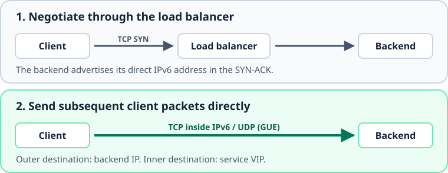

# Katran DirectEncap (KDE)

**Keep the load balancer for connection setup. Send subsequent client packets directly to the backend.**

KDE takes established IPv6 TCP traffic off the load balancer. The load balancer still chooses a backend for the SYN. If the backend accepts KDE, its SYN-ACK tells the client where to send subsequent packets directly. The application keeps using the service IP; connections that don't negotiate KDE stay on the normal path.



[Build](#build) · [Container image](#container-image) · [Client quickstart](#client-quickstart) · [Backend setup](#backend-setup) · [Verify](#verify) · [Kubernetes](#kubernetes) · [NAT](#nat) · [Upgrades](#upgrades-and-cleanup) · [Troubleshooting](#troubleshooting)

## How it works

1. A client-side BPF socket operations program (SockOps) adds a KDE TCP option to the SYN. The option advertises support and carries the client's zone. The load balancer forwards the SYN as usual; it doesn't participate in the KDE option exchange.
2. The backend's SockOps program checks its policy and, if it accepts, adds its direct IPv6 address to the SYN-ACK.
3. The client's traffic control (TC) egress program wraps subsequent packets in IPv6/UDP using Generic UDP Encapsulation (GUE). The **outer destination** is the backend's direct IP. The **inner destination** is still the service's virtual IP (VIP). After decapsulation, the backend sees the original destination on the same TCP connection.

KDE does not replace the load balancer or the Kubernetes CNI, and does not change the server-to-client path.

## Build

From the root of the exported Katran repository, with Katran's normal CMake dependencies plus `clang`, `bpftool`, and the development packages for `fmt`, `fbthrift`, `fb303`, and `opentelemetry-cpp`:

```sh
cmake -S . -B build -DKATRAN_BUILD_KDE=ON -DKATRAN_BUILD_BPF=OFF
cmake --build build --target katran_de_ctl
```

Add non-system dependency prefixes to `CMAKE_PREFIX_PATH` if CMake cannot find them. `KATRAN_BUILD_BPF=OFF` skips the unrelated Katran load balancer BPF build; KDE still builds its own BPF objects. The client binary is `build/katran/kde/katran_de_ctl`.

To build with the dependency versions selected by Katran's CI, use `getdeps` from the exported checkout:

```sh
python3 tool/fbcode_builder/getdeps.py --allow-system-packages build --src-dir=. katran
```

## Container image

CI publishes a client image from `main` to GitHub Container Registry (`ghcr.io/facebookincubator/katran-kde:latest` and `ghcr.io/facebookincubator/katran-kde:sha-<commit>`):

```sh
docker run --rm ghcr.io/facebookincubator/katran-kde:latest --help
```

The image runs `katran_de_ctl` directly. Pass `run`, `status`, or `clean` and their flags at deployment time; with no arguments it prints help and does not attach BPF.

To build the image yourself, the [Dockerfile](Dockerfile) packages the Ubuntu 24.04 CI artifact without rebuilding KDE or its dependencies. Download `katran.zip` from a successful [Linux CI run](https://github.com/facebookincubator/katran/actions/workflows/getdeps_linux.yml) matching the target node architecture, then from the root of the GitHub checkout:

```sh
unzip katran.zip -d _artifacts
docker build -f katran/kde/Dockerfile -t katran-kde:local _artifacts/linux
docker run --rm katran-kde:local --help
```

The build context is the directory containing `bin/katran_de_ctl`, not the source checkout. To produce `_artifacts/linux` locally on Ubuntu 24.04 after installing the `getdeps` system dependencies (including `patchelf`), run the CI build and packaging commands:

```sh
python3 tool/fbcode_builder/getdeps.py --allow-system-packages build \
  --build-type RelWithDebInfo --src-dir=. katran --project-install-prefix katran:/usr/local
python3 tool/fbcode_builder/getdeps.py --allow-system-packages fixup-dyn-deps \
  --strip --src-dir=. katran _artifacts/linux \
  --project-install-prefix katran:/usr/local --final-install-prefix /usr/local
```

## Client quickstart

Use a Linux host with cgroup v2, a mounted BPF filesystem (`bpffs`), and permission to load and attach BPF programs. Start with a working IPv6 TCP service that has a [KDE-capable backend](#backend-setup). Use the interface where the client's TCP packets egress and the narrowest cgroup that covers the intended workloads. Attaching higher in the cgroup tree also affects descendants.

```sh
KDE_CTL="$PWD/build/katran/kde/katran_de_ctl"
CGROUP=/sys/fs/cgroup/my-workload  # replace with the workload's existing cgroup
IFACE=eth0                       # replace with its egress interface
PIN_DIR=/sys/fs/bpf/kde-client

sudo mkdir -p "$PIN_DIR"
sudo env KATRAN_DE_PIN_PATH="$PIN_DIR" "$KDE_CTL" run \
  --cgroup="$CGROUP" --iface="$IFACE" --zone=zone_1
```

`run` stays in the foreground and cleans up on `SIGINT` or `SIGTERM`. Use `install` with the same flags for a detached instance; it pins by default. To remove a detached instance, run `clean` with the same cgroup, interface, and pin directory.

| Client setting | Meaning |
| --- | --- |
| `--cgroup` | Required for `run`, `install`, and `clean`. Scope of the SockOps attachment. |
| `--iface` | TC egress interface. Defaults to `eth0`. In host mode, use the node's egress interface. |
| `--zone` | One of `zone_1` through `zone_4`, or `none`. Defaults to `zone_1`. The backend decides which zones to accept. |
| `--host-mode` | Use one instance for the selected cgroup and a host egress interface. See [Kubernetes](#kubernetes). |
| `--nat-mode` | Compensate for client-side source-port translation. See [NAT](#nat). |
| `--kde-port` | Send GUE to UDP port `9887` instead of the default `9886`. The receiver must listen on the same port. |
| `KATRAN_DE_PIN_PATH` | Directory on bpffs for this instance's pins. If unset, KDE uses `LIBBPF_BPF_TOKEN_PATH` if set, otherwise `/sys/fs/bpf`. |

## Backend setup

The open-source CLI configures **clients**. On the backend, embed [`katran_de::DirectEncapServerApi`](api/DirectEncapServerApi.h) and call `installWithParams` with `cgroupPath`, `iface`, the direct IPv6 address in `directIp`, and the accepted zones in `serverZones`. The default zone is `zone_1`; `all` accepts any zone and `none` opts out of KDE. The server can also restrict negotiation to particular destination VIPs with `vipsEnabled` or exclude them with `vipsDisabled`.

Advertise an address that stays reachable from the client networks for the lifetime of the connection. The SockOps server advertises the address; it does **not** install the decapsulator. Allow the chosen GUE UDP port from the intended client networks, and configure the backend to decapsulate and deliver the inner packet to the existing TCP connection. Check MTU headroom for the outer IPv6 and UDP headers.

## Verify

From another shell with the same `KDE_CTL` and `PIN_DIR` values:

```sh
sudo env KATRAN_DE_PIN_PATH="$PIN_DIR" "$KDE_CTL" status
sudo env KATRAN_DE_PIN_PATH="$PIN_DIR" "$KDE_CTL" stats --details -l 2
```

`status` checks pinned statistics and reports observed errors; it does not prove a connection used KDE. Open a **new** connection from the configured cgroup, send application traffic, and check that `opt_rcvd` and `encap_ok` increase. On a busy client, confirm the test flow with a packet capture: its SYN goes to the VIP and its encapsulated packets go to the backend's direct IPv6 address. A successful application request alone may have used the load balancer.

For a single machine-readable snapshot, use `stats --json --json-delta-sec=0`. `stats --version-check` also checks that the loaded BPF program versions match the CLI's expected version.

## Kubernetes

Use an existing CNI such as Cilium. For a node-wide client, run the [container image](#container-image) with `run --host-mode`, a cgroup covering the intended workloads, the node's egress interface, and a node-local pin directory. Host mode uses TCX (Linux 6.6 or newer). A DaemonSet is the Kubernetes controller that runs one pod per selected node. It needs access to the node's network namespace, cgroups, and bpffs, with permission to attach BPF. This repository does not yet ship a DaemonSet manifest or Helm chart.

In per-workload mode, TC finds KDE state in the socket's BPF storage. At host egress, forwarded packets may have no socket attached, so host mode looks up the packet's IPv6/TCP tuple instead. SockOps and TC share the same tuple map **within one KDE instance**. Choose an egress hook where the tuple is still recognizable, and verify the accelerated path respects your network policy.

## NAT

Enable `--nat-mode` where source NAT can remap TCP ports, including Cilium masquerading deployments where collisions may only show up during a rollout. A NAT-capable backend echoes the observed port in the SYN-ACK so KDE can write it into subsequent encapsulated packets. No echo means no port correction.

Leave it off on paths that preserve the source port. NAT mode increases the KDE option from 3 to 4 bytes on the SYN and from 18 to 20 on the SYN-ACK. It also takes the port rewrite and checksum path on each encapsulated TCP packet when the backend echoes a port, even if that port hasn't changed.

NAT mode corrects the inner **source port**. It does not fix source-IP translation or a host-mode lookup that misses because the tuple has already changed. If only the outer source IP is translated, the backend must normalize the inner source as needed. [`tc_srcmatch`](../decap/tc_bpf/tc_srcmatch.bpf.c) does this before decapsulation on KDE port `9887` when the outer source matches the IP the backend saw on the SYN. For that setup, add `--kde-port` to the client command.

## Upgrades and cleanup

Keep **one host-mode owner per node and attachment scope**. For a single DaemonSet, use a rolling update with `maxSurge: 0` to avoid starting an extra replacement pod on the same node. It does not coordinate two separate DaemonSets and does not preserve connection state. Don't share a pin directory between independent instances.

On a graceful `run` shutdown, KDE detaches its programs and removes its pins. The replacement loads fresh maps; only new handshakes populate them. Stopping a standalone KDE pod doesn't close application sockets in other pods, but existing flows stop encapsulating. They can continue only if the load-balanced path still reaches the same backend with the same TCP tuple. Drain workloads before replacing KDE if disruption is unacceptable; rolling back the pod does not restore old map entries.

A forced exit can leave pinned attachments behind. On a subsequent start with the same pin directory, KDE attempts to clean them up before attaching; it does not adopt their flow maps. To explicitly clean up a stopped or detached instance:

```sh
sudo env KATRAN_DE_PIN_PATH="$PIN_DIR" "$KDE_CTL" clean \
  --cgroup="$CGROUP" --iface="$IFACE"
```

## Troubleshooting

| Symptom | What to check |
| --- | --- |
| `status` can't find maps | Compare `KATRAN_DE_PIN_PATH` with the install environment. Check that bpffs is mounted and the install pinned successfully. |
| Client `opt_sent` rises but `opt_rcvd` does not | Check whether the backend receives the KDE option and sends one back (`server_opt_set`). If it doesn't, check the zone and VIP policy and whether a middlebox strips the option. |
| Negotiation works but `encap_ok` doesn't rise | Check the TC attachment, egress interface, and host-mode tuple lookups (`in_tuple_store`). A tuple miss by itself is normal for traffic not using KDE. |
| Encapsulation rises but the connection stalls | Check route, UDP port, MTU, backend decapsulation, and the source IP and port seen on the SYN versus after decapsulation. |

To check the attachments themselves, use `sudo bpftool cgroup show "$CGROUP"` for SockOps and `sudo bpftool net show dev "$IFACE"` for TCX. For legacy TC, use `sudo tc filter show dev "$IFACE" egress`.

## Source map

| Location | Responsibility |
| --- | --- |
| [`bpf/`](bpf/) | TCP option negotiation, per-flow state, and egress encapsulation. |
| [`core/`](core/) | Load, attach, pin, and clean up BPF programs; collect stats. |
| [`api/`](api/) | C++ client and backend lifecycle APIs. |
| [`ctl/`](ctl/) | Client CLI, cross-process stats, and status. |

To run KDE's open-source unit tests, configure with `-DBUILD_TESTS=ON`, build, and run `ctest --test-dir build -R 'kde_(api|cli_parser)_test' --output-on-failure`.
